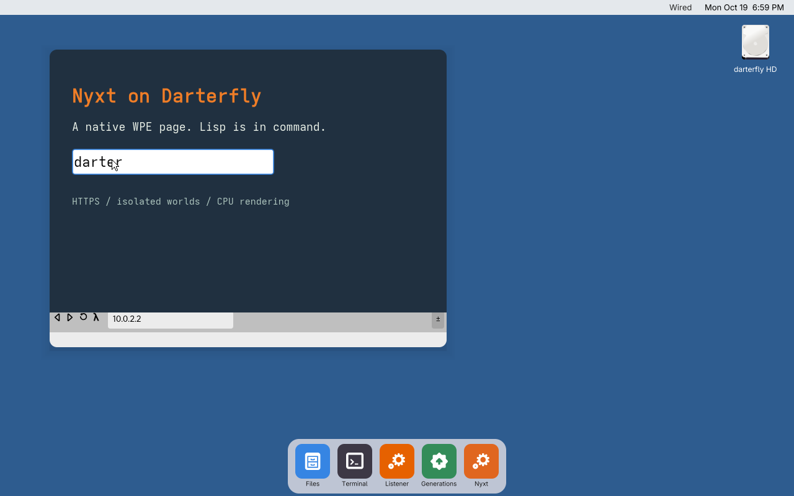

#+title: Nyxt: from native browser proof to supported Darterfly application
#+date: 2026-10-19
#+startup: overview

* Decision and scope

Keep Nyxt and WPE. The application, engine and native display/input path work.
The next milestone is a maintained desktop application on current master, with
durable state, predictable resource use and recoverable failures. No engine
change, Linux runtime or new browser implementation is proposed.

This document separates measured milestones from remaining acceptance gates.
The original browser record is historical. The current integration also uses
a resumed source-build disk; it does not qualify a clean installation.

* Overall status

Native browser bring-up is working. Upstream Nyxt runs in an isolated Lisp
world; WPE provides HTML/CSS/JavaScript and HTTPS, with native windows and
basic input through the normal Dock/init/WindowServer path. There is no
Linux runtime, and the pinned Nyxt source remains unchanged. WPE and its
dependencies still have target-port patches and are cross-built.

This is a working native browser under qualification, not yet a supported
browser for daily use. The remaining work is application reliability and
completion: lifecycle stress, scrolling/clipboard/window interaction,
durable profiles and database locks, authority review, and a reproducible
clean install. Broader site coverage and resource measurements are also
unqualified. Passing an individual test below does not close those gates.

The current dispatch changes remove blocking native output and unbounded
callback creation. The complete single-guest browser/dispatch/recovery run
passes after both late-reply cleanup fixes. See [[file:DISPATCH.org][the dispatch notes]] and
[[file:dispatch-evidence.json][the exact revision and evidence]]. This closes the blocked-frame-consumer
gate, not the remaining lifecycle, interaction or persistence gates.

Master has advanced beyond the integrated 54ef189 baseline. Review against
facd54d found a concrete ABI collision: master uses operation 85 for
=calls-live=, while this branch uses it for native process signals. Resolve
that collision and rebuild affected native runtime consumers before merge.
Master also now requires explicit world placement for applications, bounds
service dispatch, and changes world-call reclamation. Preserve Nyxt's
explicit isolated-world launch and both sets of call-lifetime fixes, then
qualify the integrated revision. This branch's guest result does not qualify
an assumed future merge result.

* Proven baseline

The recorded actual-OS run starts upstream Nyxt in an isolated Lisp world,
renders a controlled HTTPS page through WPE, evaluates JavaScript, accepts
QEMU HID clicks/typing, opens Nyxt's Ctrl-L prompt and navigates on Enter.
Trusted UI Lisp callbacks execute; the same callback from the HTTPS page is
denied. Engine, adapter and world exit successfully and native children are
reaped. The separate host run passed 84 checks.

The renderer extension changes no Nyxt application source. WPE and its
dependencies have a target port and patches; keeping Nyxt unchanged does not
mean the entire dependency stack is unmodified. The engine remains
cross-built. OCICL supplies Nyxt's Lisp-side TLS; WPE uses its existing native
network/TLS stack. Keep those established consumers and shared libsa.

See [[file:browser-evidence.json][the browser evidence]], [[file:NYXT-RENDERER.org][implementation notes]], [[file:nyxt-build-evidence.json][the earlier clean-disk core build]], and [[file:render-evidence.json][the engine baseline]].

* Branch integration (completed 2026-10-19)

The initial review found HEAD 5e25835, an unfinished D2 merge and substantial
uncommitted browser work. A complete source/index/merge-state snapshot was
saved before changes. Commits 784ee56 and 23ec577 preserve that work; 8ccace8
integrates master 54ef189. The active master worktree was not edited.

Master's native syscall IDs 80--84 and newer world rights checks are
preserved. The browser's colliding signal operation moved to 85. The denied
native-call probe covers the protected operations, including that signal.

Master already has app worlds, init supervision and a world-facing
WindowServer service. Its app entry points are src/apps/open.lisp and
src/init/init.lisp; the display client is src/layer/world.lisp. The normal
application now uses that existing service directly from the Nyxt world. The temporary Nyxt Windows process and frame socket are removed.

- [X] Preserve a recoverable snapshot of HEAD, merge/index state, tracked
  changes and all untracked source/evidence before rearranging work.
- [X] Reconcile the pending D2 merge without attributing its hardware/audio
  work to the browser change. Preserve the tested browser state while
  preparing reviewable commits.
- [X] Integrate current master in this browser worktree or an isolated
  integration checkout. Preserve newer world rights, native syscall numbering,
  app lifecycle and network-driver changes; do not copy older files wholesale
  over master.
- [X] Leave the active master worktree and its local documentation/design
  edits untouched. Compare against master again before the final merge.
- [X] Boot the integrated base and rerun the existing browser baseline before
  adding more browser features. Retain the old evidence as historical
  evidence.

* Normal application qualification (passed 2026-10-19)

The actual QEMU OS boots normal init and launches Nyxt from a real Dock
click into its registered app world. The existing Layer client supplies the
window and HID input. A second Dock click reuses the instance. The test
passes HTTPS with the system CA bundle plus a test-only fixture CA,
JavaScript, trusted UI callbacks, denied web callbacks, typing, Ctrl-L and
Enter navigation, and a late update to a deleted prompt. It then uses
upstream Ctrl-Q, verifies init's exit history reports zero, and checks that
native children and the WindowServer client are gone. Dock relaunch and a
second clean Ctrl-Q exit pass too.

Shared libsa input buffering fixes the system-CA load that previously kept
WebKit's main thread busy until its responsiveness watchdog killed the
NetworkProcess. No trust exception or watchdog relaxation was added.
The renderer now implements Nyxt's uninstall interface as well as install.

The host regression suites pass 87 checks. Actual-OS regressions pass
43 native-process/runtime checks and 9 existing app-world/WindowServer
checks. The native runtime probe includes mixed buffered input, pushback,
positioning, pipes, caller-owned buffers and 4,096 lines, both before and
after rebuilding the probe inside Darterfly.

See [[file:app-evidence.json][the normal-app evidence]], [[file:qualification-logs/nyxt-app-guest.log][guest transcript]],
and . All 5,615 pinned Nyxt source files
still match their manifest. This is a resumed dependency-cache disk with
a newly staged application package, not a fresh source build/install.
Two successful launch/quit cycles do not satisfy the 20-cycle stress gate.
Startup dependency/deprecation warnings remain visible in the transcript.
The older cached/resumed browser harness also passes against the same
engine binaries, including input, navigation, exit zero and child reaping.
Its [[file:qualification-logs/integrated-browser-host.log][regression transcript]] is separate from the preserved historical record.

* Source findings that block dependable use

** Application lifecycle

Nyxt now uses init's existing restart-on-crash policy with a three-exit
budget per ten minutes. Normal quit does not restart. The app and engine
have bounded liveness/transport/shutdown paths and kernel-TID-specific socket
names. A failed session is replaced as a whole; native descendants and
windows are reclaimed by the existing world ownership machinery. See
[[file:RECOVERY.org][recovery design and qualification]] for the exact limits and test procedure.

Renderer state still resides in one application's globals, with no supported
in-place restart of that heap. Persistent tabs, user-facing failure controls,
long lifecycle stress and simultaneous-failure qualification remain work.

The full single-guest recovery sequence now passes, including seven failure
injections, retry exhaustion, manual retry and clean quit without restart.
Repeated launches exposed kernel termination races, VM-map fragmentation
and leaked joined-thread storage; the shared OS fixes have 133 actual-OS
regression checks. The separate host checks pass 88 assertions. See
[[file:recovery-evidence.json][the recorded recovery evidence]]. This is a recovery milestone, not the
20-cycle/long-soak or fresh-install qualification.

** Event ordering and backpressure

The native GLib loop now queues output and pumps bounded batches without
waiting for a blocked socket. Pending frames coalesce by view; partial
packets finish intact and control replies retain FIFO order. Both pending
frame queues have count/byte caps. Requests and control output are bounded.

The Lisp reader resolves RPC replies independently of presentation. Four
fixed workers replace per-event threads: one FIFO event worker, two scheme
workers and one presentation worker. View deletion drops queued work and
cancels native scheme requests. Shutdown closes the queues and wakes their
workers. See [[file:DISPATCH.org][ownership, exact limits and qualification procedure]].

This does not serialize every upstream command or layout mutation. Stress
navigation generations, deletion, GC and signal interruption before claiming
complete event-lifetime correctness. Hidden-view throttling, damage tracking
and reducing frame copies remain efficiency work.

** Persistence

nyxt-engine.cpp explicitly uses webkit_network_session_new_ephemeral.
src/bsd/libsa.lisp supports descriptor fcntl operations but rejects record
locks. SQLite's in-memory test is not evidence for safe browser databases.
src/libsa/vfs.lisp and the BSD service also need their durability contracts
checked against actual storage.

Implement the actual record-lock and synchronization behavior needed by the
pinned SQLite/WebKit configuration in shared libsa/BSD/VFS. Confirm its
journal/WAL and shared-memory requirements from the selected build. Never
substitute successful no-op locks. Then use per-user persistent data/cache
directories with a profile lock. Preserve Nyxt's own history, bookmarks and
configuration separately from WebKit data.

** Normal interaction

The adapter currently forwards key-down and left-button events; the engine
synthesizes immediate key-up. There is no complete pointer motion/wheel, drag,
secondary button, real key-up/repeat or focus transition path. Windows start
at fixed dimensions; setting the Nyxt window title is a no-op. Several
renderer interfaces, including named JavaScript worlds, explicitly report
unsupported behavior.

Use current layer/kit windows and existing input facilities. Define
key/modifier translation explicitly rather than assuming bit layouts match
WPE. Inventory Nyxt's foreign interface against this extension, exercising
each exposed command or marking unsupported capabilities visibly. Do not
silently report success for operations that did nothing.

** Fault containment and authority

The callback test is useful but narrow. It does not establish a complete
malicious-content sandbox. The native service routes requests to the sender's
BSD process, but process-scoped descriptors and isolated heaps alone do not
prove restricted file, process or service access.

Audit the actual rights and inherited descriptors of each browser process
against current master. Grant only the services it needs and verify denial of
unnecessary hardware/world-control authority. Review internal schemes,
subframes, redirects, navigation races and resource/file access. Test the
boundary using hostile documents, not only the successful trusted callback.
State any remaining filesystem or network authority plainly before treating
the browser as suitable for arbitrary untrusted sites.

** Build and maintenance

The build is pinned and has source/evidence manifests, but scripts still rely
on assessment directories, an existing /tmp Nyxt checkout, scratch-root
pointer files and some hard-coded store paths. Build options disable JIT,
WebAssembly, video/audio, WebGL and several content features including WOFF2.
CPU rendering works; broad modern-site coverage and performance remain
unmeasured.

Provide a declared build/staging/install entry point from pinned sources, with
discoverable Guix inputs, licenses and the actual target closure. Distinguish
host build dependencies from installed runtime files. Keep WPE patches small
and explained, remove obsolete workarounds only after proving them
unnecessary, and establish an engine update/retest procedure. Preserve
reusable qualification probes; separate historical CEF research from the
supported WPE route.

* Ordered implementation and acceptance gates

** 1. Current master and a normal application

Deliver the integrated baseline, a Nyxt application bundle/entry point, an
init-managed app world and direct use of the existing WindowServer client.
Keep the WPE process boundary; remove the redundant window broker once the
replacement passes. Browser-specific core, data and memory settings should be
explicit rather than silently inheriting the small default app budget.

- [X] From a fresh boot, open Nyxt through the normal desktop path without
  host REPL injection, fixture services or manual loads.
- [X] Reuse the existing instance on a repeated Dock click; browse through
  upstream URL entry, quit successfully and relaunch from the Dock.
- [ ] Open a supplied URL and a second window/buffer; focus an existing
  instance when appropriate. Define one-owner-per-profile behavior.
- [ ] Close and reopen 20 times; test partial startup failure and stale
  endpoints. No orphan windows, descriptors, sockets, children or live session
  threads remain after cleanup.
- [ ] Other desktop apps and network-driver worlds continue to work.

** 2. Bounded transport and recoverable failures

Deliver session ownership, ordered/bounded events, nonblocking frame output,
cancellation and visible failure handling. Asynchronous page JavaScript
errors no longer poison the global *failure* flag; view submission/deletion
is serialized for late prompt updates. Engine loss should become an
actionable browser state, not an unbounded wait.

- [X] Kill WebProcess, NetworkProcess and UI process separately; check new
  app worlds, old child/window cleanup, retry limits and working HTTPS/JS.
- [X] Stop the Nyxt world, pause the UI with its socket open, and pause the
  Lisp world. Verify bounded recovery/cleanup through normal OS ownership.
- [X] Recover from an unhandled Bordeaux worker error; manual launch resets
  the failure budget and clean quit stays stopped.
- [ ] Close actual OS sockets mid-header and mid-frame. Host transport tests
  cover partial packets and blocked writers; guest truncation injection is
  still required.
- [X] Pause presentation and the real engine socket reader while the page
  animates. Queues stay within configured limits, RPC/input processing
  continues, and the presentation cache converges to the final frame.
- [ ] Stress navigation, buffer deletion and GC/signal interruption. No lost
  bytes, stale callbacks, use-after-delete or reply-table growth.

** 3. Interaction sufficient for real work

Deliver scrolling, motion/drag, selection, keyboard modifiers/repeat, focus,
native window resize/close/title, clipboard, buffer switching,
back/forward/reload and visible load/TLS errors. Implement file selection and
downloads through existing OS facilities, with explicit destination ownership
and cancellation.

- [ ] Read and scroll a long document; select/copy/paste text between Nyxt and
  Editor.
- [ ] Fill and submit forms, use multiple buffers, resize windows and close
  them from normal controls.
- [ ] Download a fixture file, verify its hash on disk, and upload a selected
  file. Cancellation leaves no misleading completed file.
- [ ] Inventory renderer methods, including user scripts and named JS worlds;
  qualify Nyxt commands that depend on them.
- [ ] Resolve the observed background suggestion timeout and
  certificate-parsing warning without suppressing failures or relaxing
  certificate validation.

** 4. Durable profiles and correct trust

Deliver shared-runtime storage primitives and persistent WebKit/Nyxt profiles.
Install the normal CA store, use the actual system clock and keep fixture
CA/environment overrides confined to tests.

- [ ] Cookies, local storage, bookmarks, history and settings survive browser
  restart and OS reboot. Exercise the storage APIs enabled in the shipped
  engine, including IndexedDB if enabled.
- [ ] Two processes contend for database/profile locks correctly. Kill the
  writer during a transaction; reopen and run database integrity/recovery
  checks.
- [ ] Test real guest reset/power-loss behavior separately from clean reboot
  and document the filesystem's durability guarantees.
- [ ] Reject untrusted, expired and wrong-host certificates; recover on the
  next valid load. Display errors to the user without a silent verification
  bypass.

** 5. Measured efficiency and site coverage

Start with current CPU rendering and interpreter. Measure before choosing
shared surfaces, JIT or other large changes. The existing 8 GiB guest and 2
GiB supervisor heap are test settings, not a justified minimum requirement.

- [ ] Record cold/warm startup, idle CPU, resident memory per world, frame
  bytes/copies, callback counts and input-to-present latency on a fixed QEMU
  configuration.
- [ ] Run at least 30 minutes of navigation, scrolling and buffer
  create/delete. After warm-up and GC, resource counts return to a stable
  baseline rather than growing each cycle.
- [ ] Compare before/after frame coalescing and removal of the extra window
  hop. Hidden/static views should not consume continuous full-frame bandwidth.
- [ ] Qualify a reproducible local site suite and a recorded selection of
  public documentation, search and form-heavy sites. Fix missing features
  required by that baseline; do not equate one HTTPS fixture with general
  compatibility.
- [ ] Establish a measured memory configuration and graceful low-memory
  behavior. The desktop must remain usable when a page exhausts its
  allocation.

** 6. Reproducibility, review and merge

Deliver a clean build/install path, concise current docs, source/license
manifests and reviewable changes grouped by responsibility: shared runtime,
engine port/build, Nyxt renderer, desktop integration and qualification.

- [ ] Build and install from a fresh directory without the old scratch tree or
  preexisting source checkout; preserve source hashes and complete build
  instructions.
- [ ] Run existing runtime/network/native-tool regression suites affected by
  the diff and current master app-world/init tests.
- [ ] Run the browser gates on a clean installed guest and again after reboot.
  Include a manual desktop session and host-independent launch.
- [ ] Validate the final integrated revision, not just earlier screenshots.
  Record skipped features, warnings and measured resource requirements.
- [ ] Review the final integration and staged/untracked files; keep generated
  disks, caches and transient build products excluded. Preserve compact
  evidence and runnable tests. The earlier pending D2 merge is resolved.
- [ ] Merge the validated branch into master and repeat installed-OS smoke
  tests on the resulting merge revision. Keep the previous boot generation
  available for rollback.

* What does not block the first supported version

GPU acceleration, JIT, WebAssembly, video/WebRTC, extensions and rebuilding
all of WebKit inside Darterfly are separate milestones. Reassess a disabled
feature only when a required browser workflow demonstrably needs it.
Unsupported media or APIs should fail clearly; do not promise all modern sites
will work.

A foundation commit can be reviewed or merged earlier if it is independently
useful and tested, but that does not satisfy this browser milestone. Ready
means an ordinary user can launch it, browse the qualified sites, keep work
across reboots, and recover from failures using the desktop's existing
facilities.

* Immediate next change

The combined browser, bounded-dispatch and full crash-recovery run is now
recorded. First reconcile newer master, including the operation-85 collision,
explicit app-world placement and overlapping call-lifetime fixes. Rerun the
combined qualification on that integrated revision.

Then qualify socket truncation, navigation/deletion/GC interruption and the
20-cycle lifecycle test. Follow with durable profiles and database locks,
complete interaction, authority review and fresh-install reproducibility.
The branch remains under qualification for daily use and final merge.
